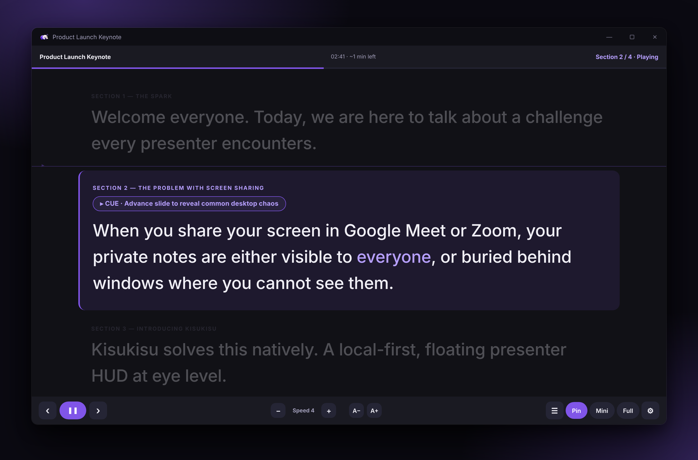
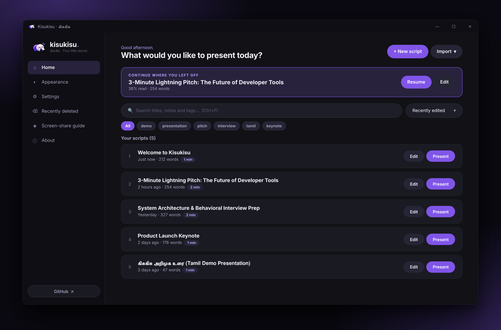
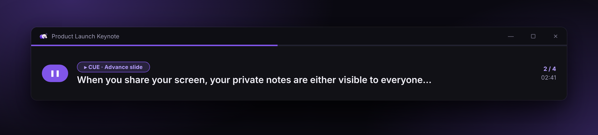
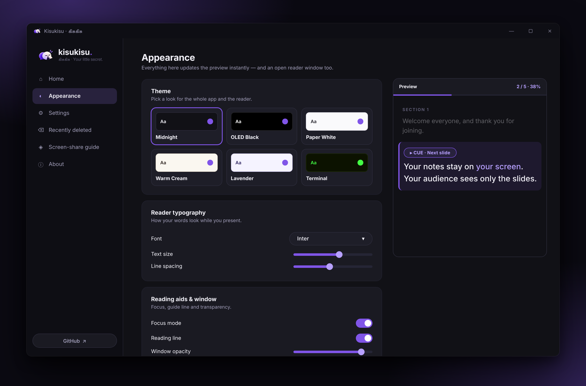
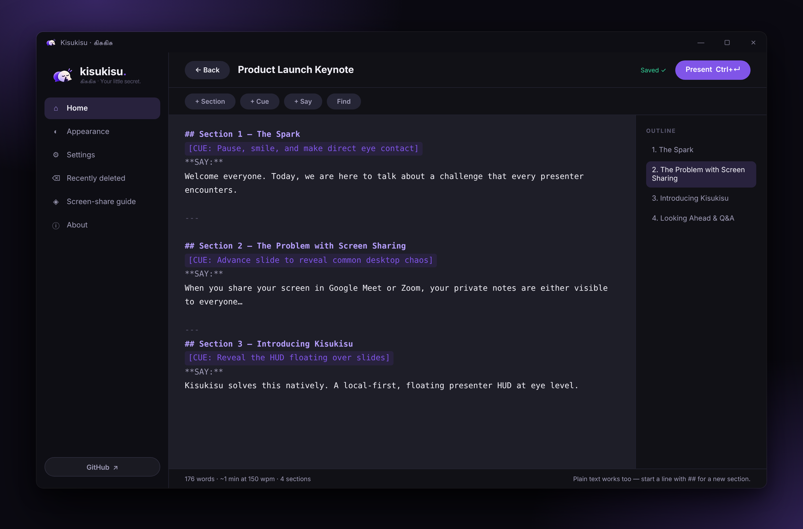
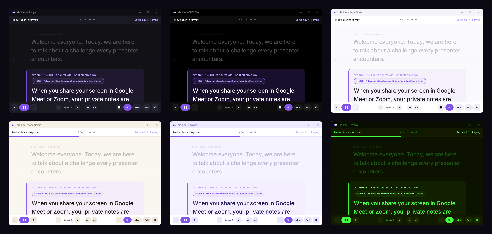

<div align="center">
  

# kisukisu · <span lang="ta">கிசுகிசு</span>
### *Your little secret.*

**A private, local-first presenter companion — read your script, hit your cues, and speak with confidence on Zoom, Meet and Teams.**

[](https://github.com/MKishoreDev/kisukisu/releases)
[](https://github.com/MKishoreDev/kisukisu/actions)
[](https://pypi.org/project/kisukisu/)
[](https://www.python.org/)
[](LICENSE)
[](#cross-platform-status)
[](#privacy-architecture)
[](https://github.com/MKishoreDev/kisukisu/stargazers)

[**Download .exe**](https://github.com/MKishoreDev/kisukisu/releases) · [**Quick Start**](#quick-start) · [**Capabilities**](#core-capabilities) · [**Contribute**](CONTRIBUTING.md)

<br/>

<a href="https://raw.githubusercontent.com/MKishoreDev/kisukisu/main/assets/kisukisu-launch.mp4">
  
</a>
<br/>
<sub>▶ Click to watch the full launch film (46 s)</sub>

</div>

---

## Why Kisukisu?

Whenever I conduct a workshop or give a technical presentation on Google Meet, Zoom, or Teams, I run into the same frustration:

1. **Window juggling:** Constantly switching between the shared slide window and speaker notes.
2. **Loss of eye contact:** Peeking down at a phone propped under the monitor.
3. **Accidental exposure:** The constant fear of sharing the wrong window and revealing confidential speaker notes or interview outlines to the entire audience.

Existing tools either felt bloated, demanded subscriptions and accounts, or showed up clumsily in the taskbar and screen recordings.

**Kisukisu** was built to solve this simply: an obsidian HUD that stays quietly on your screen. You see your script, your cues, and your live demo prompts. Your audience only sees your presentation.

---

## See it in action

<p align="center">
  
  <br/><sub><b>The reader</b> — focus mode keeps the paragraph you're on bright, cues are pulled out as chips.</sub>
</p>

<p align="center">
  
  <br/><sub><b>Your library</b> — search, tag filters, and a one-click "continue where you left off".</sub>
</p>

<p align="center">
  
  <br/><sub><b>Compact strip</b> — park it right under your webcam and keep eye contact.</sub>
</p>

<table>
  <tr>
    <td width="50%"><br/><sub><b>Appearance studio</b> — live preview, custom colours, typography.</sub></td>
    <td width="50%"><br/><sub><b>Editor</b> — outline, insert helpers, word &amp; time stats.</sub></td>
  </tr>
</table>

---

## Table of Contents

[Why](#why-kisukisu) · [Capabilities](#core-capabilities) · [Screen-Sharing Safety](#screen-sharing-safety) · [Themes](#themes) · [Shortcuts](#keyboard-controls) · [Quick Start](#quick-start) · [Script Format](#script-format) · [Architecture](#architecture) · [Privacy](#privacy-architecture) · [Contributing](#contributing)

---

## Core Capabilities

- **A reader that behaves like a real window:** Native title bar, minimise / maximise / resize, shows in the taskbar and Alt-Tab, and always opens fully on-screen (validated against your real monitors and DPI scaling).
- **Three modes:** Normal, **Compact** strip (park it under your webcam) and **Fullscreen** — switch with `M` / `F11`.
- **Smooth teleprompter scrolling:** Pixel-smooth auto-scroll with 10 speeds, optional *pause at each section* (ideal when a section is a slide), and *resume where you stopped*.
- **Focus mode & reading line:** The paragraph you're on stays bright; everything else fades back.
- **Cue chips:** `[CUE: Next slide]`, `[SWITCH SLIDE]`, `**ACTION:**` lines are pulled out and highlighted so you never miss a slide change.
- **Timer:** Elapsed time plus an estimate of time left at your speaking pace.
- **Fully customisable:** Fonts, size, weight, line & paragraph spacing, margins, alignment, opacity, 6 themes + your own colours (export/import to share), and **every shortcut is rebindable**.
- **Import anything:** `.md`, `.txt`, `.docx` and `.pdf` (PDF needs `pypdf`, included in requirements).
- **Safe by design:** Autosave, atomic writes, *Recently deleted* (30 days), backup & restore.
- **Screen-capture exclusion (Windows 10 2004+/11):** Optional, on by default — see below.
- **Local-first:** Zero cloud, zero telemetry, zero accounts. Everything lives in `~/.kisukisu/`.
- **Full Unicode:** Tamil (கிசுகிசு), Indic scripts and emoji alongside English.

---

## Screen-Sharing Safety

No software should promise 100% invisibility under every possible driver or capture configuration. Kisukisu provides clear, documented boundaries:

| Method | Mechanism | Audience Visibility | Recommended Use |
|:---|:---|:---:|:---|
| **Share Window / Tab** | Target specific application window | **Zero visibility** | Standard best practice for Google Meet, Zoom, Teams |
| **Share Entire Desktop** | Windows OS-level `WDA_EXCLUDEFROMCAPTURE` | **Excluded at compositor** | Full-screen live terminal / IDE presentations |
| **Dual Display** | Physical HDMI / USB-C monitor routing | **Zero visibility** | Large workshops and conference stages |

---

## Themes

Crafted with a unified violet (`#8055E8`) design system. Configurable via settings or CLI:

<p align="center"></p>

| Palette | Type | Description |
|:---|:---:|:---|
| **Midnight** | Dark | Deep charcoal obsidian glass with violet accents (default) |
| **OLED Black** | Dark | Pure `#000000` for OLED panels and maximum contrast |
| **Paper White** | Light | High-readability daylight theme |
| **Warm Cream** | Light | Soft sepia palette designed for long speaking sessions |
| **Lavender** | Light | Soft violet light mode |
| **Terminal** | Dark | High-contrast phosphor green for terminal presentations |

---

## Keyboard Controls

Present without reaching for your mouse. **Every key below can be changed in Settings → Shortcuts.**

| Key | Action |
|:---|:---|
| `Space` | Play / pause auto-scroll (double-click the text works too) |
| `→` / `←` | Next / previous section |
| `↑` / `↓`, `PageUp` / `PageDown` | Scroll |
| `Home` / `End` | Back to start / jump to end |
| `]` / `[` | Faster / slower |
| `+` / `−` | Bigger / smaller text |
| `F` | Focus mode on/off |
| `T` | Keep above other windows |
| `M` | Compact mode |
| `F11` | Fullscreen |
| `S` | Section list |
| `R` | Reset timer |
| `Esc` | Leave fullscreen / compact |
| `Ctrl + W` | Close the reader |

In the library: `Ctrl+N` new script · `Ctrl+O` import · `Ctrl+F` search · `Ctrl+,` settings · in the editor `Ctrl+S` save, `Ctrl+Enter` present.

---

## Quick Start

### 1. Download Standalone Executable (Windows — Recommended)

Download pre-compiled binaries directly from the **[Releases](https://github.com/MKishoreDev/kisukisu/releases)** page:
- **`Kisukisu.exe`**: Zero setup required. Double-click and present.
- **`Kisukisu-Windows-x64.zip`**: Portable zip archive.

> [!NOTE]
> Free code signing provided by [SignPath.io](https://signpath.io), certificate by [SignPath Foundation](https://signpath.org).

### 2. Install as Python Package (Cross-Platform)

Install directly via `pip` on Windows, macOS, or Linux:

```bash
pip install kisukisu

# Run via Python module (recommended):
python -m kisukisu

# Or direct command (if Python Scripts is in your PATH):
kisukisu
```

### 3. Run from Source

Requires Python 3.10+:

```bash
git clone https://github.com/MKishoreDev/kisukisu.git
cd kisukisu
pip install -r requirements.txt
python -m kisukisu
```

### CLI Arguments

```bash
# Import a file and open it in the reader
python -m kisukisu --file ./sample_scripts/tamil_demo.md

# Launch with a specific theme
python -m kisukisu --file ./sample_scripts/tamil_demo.md --theme oled

# Inspect version
python -m kisukisu --version
```

---

## Architecture

```
kisukisu/
├── assets/                    # Logo, dark emblem, banner, screenshots, launch video
├── kisukisu/                  # Python application package (pip installable)
│   ├── app.py                 # Entry point (CLI, onboarding, tray)
│   ├── assets/                # Embedded package icons
│   ├── core/                  # Pure logic — no Tk, fully unit-tested
│   │   ├── config.py          # Validated, atomic settings (~/.kisukisu/config.json)
│   │   ├── geometry.py        # Window clamping (monitors, DPI, off-screen recovery)
│   │   ├── shortcuts.py       # Rebindable shortcut definitions
│   │   ├── document_parser.py # Markdown/text/DOCX/PDF -> sections & cues
│   │   ├── monitor_manager.py # Display discovery (Win32 / xrandr / macOS)
│   │   └── script_manager.py  # Library, trash, backup, export
│   ├── ui/
│   │   ├── components.py      # Design system: buttons, sliders, switches, toasts, tooltips
│   │   ├── themes.py          # 6 presets + derived custom themes
│   │   ├── library_view.py    # Responsive main window shell
│   │   ├── reader_view.py     # The presenter reader + live settings panel
│   │   ├── welcome_screen.py  # First-launch onboarding
│   │   └── views/             # Home · Editor · Appearance · Settings · Guide/About/Trash
│   └── utils/                 # Platform integrations (Win32 helpers, tray, resource paths)
├── sample_scripts/            # Sample presentation scripts (Tamil demo)
├── tests/                     # Automated unit test suite (Windows, macOS, Linux)
├── .github/workflows/         # CI/CD: cross-platform testing & automated release pipeline
├── pyproject.toml             # PyPI package configuration
└── requirements.txt
```

---

## Cross-Platform Status

| Capability | Windows 10/11 | macOS | Linux |
|:---|:---:|:---:|:---:|
| Floating HUD & Auto-Scroll | Supported | Supported | Supported |
| Native Capture Exclusion | Supported (DWM) | Fallback to Window Share | Fallback to Window Share |
| Taskbar Suppression | Supported | Supported | Window Manager Dependent |
| System Tray Icon | Supported | Supported | Supported |
| Multi-Display Selection | Supported | Supported | Supported |
| Standalone Binary | `.exe` ([Releases](https://github.com/MKishoreDev/kisukisu/releases)) | `pip install` / Planned `.dmg` | `pip install` / Planned `AppImage` |

---

## Privacy Architecture

Kisukisu is built on local-first principles:
- **No telemetry:** No analytics, crash loggers, or tracking requests.
- **No network calls:** The application executes completely offline.
- **Local storage:** Scripts and configuration reside strictly in `~/.kisukisu/`.
- **No surveillance:** Kisukisu never accesses your camera, microphone, or external windows.

---

## Verification & Testing

The suite covers parsing, cue extraction, Tamil Unicode, config validation, window-geometry safety (off-screen / DPI / missing monitor), shortcuts, themes, cross-platform fallbacks, and the script library (trash, backup, restore). CI runs it across Windows, macOS, and Linux (under xvfb):

```bash
python -m unittest discover -s tests -p "test_*.py"
```

---

## Compilation

To package Kisukisu as a standalone Windows executable:

```bash
python -m PyInstaller --noconsole --onefile --name Kisukisu --clean `
  --icon assets/logo.ico `
  --add-data "assets;assets" `
  --collect-all customtkinter `
  run_kisukisu.py
```

---

## Script Format

Plain text works, but a little structure makes the reader smarter. Sections, cues and spoken text are detected automatically:

```markdown
# 3-Minute Lightning Pitch
Tags: pitch, demo, startup

## Section 1 — The Spark
[CUE: Pause, smile, and make direct eye contact with the camera]
**SAY:**
Welcome everyone. Today I want to show you…

---

## Section 2 — Live demo
**ACTION:** Open the terminal and run the demo
**SAY:**
As you can see…
```

`[CUE: …]`, `[SWITCH SLIDE]` and `**ACTION:**` lines become highlighted chips. Try the sample in [`sample_scripts/`](sample_scripts/) — including a full Tamil example.

---

## Roadmap

- [ ] macOS `.dmg` and Linux `AppImage` standalone packages
- [ ] Remote / second-device teleprompter control
- [ ] Speech-pace tracker (offline audio pitch & tempo)
- [ ] Additional import/export integrations

Have an idea? [Open a feature request](https://github.com/MKishoreDev/kisukisu/issues/new?template=feature_request.md).

---

## Contributing

Contributions of every size are welcome — bug reports, docs, translations, themes, code. Read [CONTRIBUTING.md](CONTRIBUTING.md), keep to the local-first principles, and run the tests before opening a PR. Be kind: see the [Code of Conduct](CODE_OF_CONDUCT.md). Found a security issue? See [SECURITY.md](SECURITY.md).

If Kisukisu helps you present with more confidence, a ⭐ helps others discover it.

---

## The Story Behind the Name

**Kisukisu (கிசுகிசு)** is inspired by the Tamil word for *whisper* or a hushed, private conversation. 

The tool was designed to embody that quiet quality: it stays close while you speak, keeps your thoughts in order, and never steals focus from your audience.

Built out of a personal need. Shared openly for anyone who speaks, teaches, or presents.

---

## License

Released under the [MIT License](LICENSE).  
Copyright (c) 2026 Kishore M & Kisukisu Contributors.
